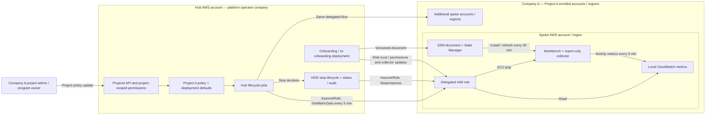

# Workbench shutdown policy and hub-managed idle stop

The hub manages shutdown policy centrally. Workbenches report activity from their spoke AWS
accounts; the hub evaluates policy and requests stops through VEW's existing lifecycle. A stop
stops the instance; it does not terminate the provisioned product. These policies never start a
workbench automatically.

## Ownership and policy inheritance

The effective policy follows **deployment defaults → project policy → allowed owner overrides**.
For a company deployment, the recommended mapping is one company per project, with several spoke
accounts and regions enrolled in that project. A separate company can operate the hub. This is a
deployment convention: VEW enforces project permissions, not corporate identity.

- **Platform operators** configure deployment defaults, schedules, idle evaluation rules, and
  collector delivery. The API supplies the authoritative defaults to the portal.
- **Project administrators and program owners** set the project policy. With the company/project
  mapping, this is the company's policy for its enrolled workbenches. Permissions isolate projects.
- **Workbench owners** use their workbench's **Settings** for overrides the project allows. A
  stored override is ignored if permission is later removed or its timeout falls outside new bounds.

An absent project policy inherits platform defaults. Within an explicit policy, `null` for
`idleStopMinutes`, `nightlyStop`, or `weekendStop` inherits that individual platform value;
`false` explicitly disables the corresponding scheduled stop. An organization can agree to
inherited defaults during onboarding or set an explicit project policy. There is currently no
separate per-spoke or customer consent flag.

`alwaysOn` bypasses idle, nightly, and weekend stops and disables owner overrides. Product
`AutoStopProtection` remains respected by automatic stops. Nightly and weekend shutdown are
separate policies; disabling nightly shutdown does not disable weekend shutdown.

## Managing policy in the portal

Select a program in the portal's program selector, then open **Administration → Program details →
Shutdown policy** (`/administration/program`). Project-scoped `ADMIN` and
`PROGRAM_OWNER` users can edit portal-managed projects:

| Control | Policy field | Behavior |
|---|---|---|
| Default idle timeout | `idleStopMinutes` | Explicit minutes or inherit platform; 10–1440 minutes |
| Nightly shutdown | `nightlyStop` | Enable, disable, or inherit; time and timezone come from the deployment |
| Weekend shutdown | `weekendStop` | Enable, disable, or inherit; separate weekend schedule |
| Always on | `alwaysOn` | Bypass automatic shutdown for the project's workbenches |
| Allow owner to disable nightly shutdown | `allowUserDisableNightlyStop` | Permit the workbench Settings override |
| Allow owner to change idle timeout | `allowUserIdleTimeout` | Permit a timeout within the project's bounds |
| Owner timeout bounds | `userIdleTimeoutMinMinutes`, `userIdleTimeoutMaxMinutes` | Each 10–1440 minutes; minimum must not exceed maximum |

Resetting the project policy removes the stored policy and restores inheritance, including the
default of disallowing owner overrides. Projects managed externally through S2S/Terraform are
read-only in the portal; their policy is maintained through that management path
(`vew_project_workbench_lifecycle`).

The authenticated Projects API exposes `GET`, `PUT`, and `DELETE`
`/projects/{projectId}/workbench-lifecycle`. Responses contain:

| Field | Meaning |
|---|---|
| `projectId` | The project whose policy was requested |
| `settings` | Stored project policy, or `null` when inherited |
| `platformDefaults` | Authoritative idle timeout, nightly/weekend defaults, nightly time, and timezone |
| `deployment.idleStopEnabled` | Whether hub idle stopping is enabled for the environment |
| `deployment.nightlyStopScheduleEnabled` | Whether the deployment's nightly schedule is available |
| `canEdit` | Whether this caller may edit this project's policy in the portal |
| `managedBy`, `managedSource` | Optional external management details for a read-only project |

`PUT` replaces a policy and `DELETE` removes it; the server checks project authorization and external
management status. Workbench **Settings** remain the owner's choices within these project rules.

## Account boundaries and delegated control

Spoke onboarding establishes IAM trust for the hub and installs the management roles and
permissions, including `cloudwatch:GetMetricData` and `ec2:StopInstances`. The spoke account
administrator authorizes this delegation; project policy controls how VEW uses it. Collector
installation is not a grant or revocation of stop permission.

The following is the intended cross-company deployment mapping using the existing hub/spoke
mechanism. Each company's AWS policies must permit the configured hub trust and delegated actions.
It does not introduce a separate spoke decision service or executor.

Policy changes take effect in hub evaluation without rebuilding AMIs. The lifecycle reconcile
job also delivers effective timeouts through the `vew:autostop` instance tag. Collector code changes
are delivered with the spoke SSM document and re-onboarding, as described below.

## Idle telemetry and decision flow

1. **The workbench reports.** An idle agent on the workbench (`backend/infra/usecase/resources/workbench_agents/idle/`)
   publishes every 5 minutes to CloudWatch in the workbench account, namespace `VEW/Workbench`,
   dimension `InstanceId`:
   - `DcvConnections` - connected DCV clients;
   - `InteractiveSessions` - SSH/console logins plus SSM Session Manager sessions;
   - `LoadPerCpu` - 5-minute load average per CPU;
   - `IdleMinutes` - the agent's own counter (informational).

   The selected flow is report-only (`ACTION=report`). The script also has an `ACTION=stop` local
   fallback, but that is not the hub-managed deployment flow. Session Manager detection matches the
   worker's full executable command, including its path, because Linux truncates process names to
   15 characters. RunCommand workers and the collector's own probes are excluded.

   A successful empty DCV session or connection listing reports zero clients. An installed DCV CLI
   that fails or returns an unrecognized session listing omits `DcvConnections` and resets the local
   informational idle counter; it never publishes that failure as zero activity. The collector
   supports the [documented unquoted session IDs](https://docs.aws.amazon.com/dcv/latest/adminguide/managing-sessions-lifecycle-view.html)
   and older quoted IDs. An optional absent DCV CLI remains distinguishable in the log
   (`dcv_probe=absent`) from a failed installed CLI (`dcv_probe=failed`).
2. **The hub decides.** The provisioning scheduled job `WorkbenchLifecycleJob` action `idle-stop`
   (rule `<prefix>-provisioning-workbench-idle-stop-<env>`) reads each running workbench's signals
   through the provisioning role it already assumes in the workbench account
   (`cloudwatch:GetMetricData`). It stops through VEW's stop path when each selected signal has
   sufficient samples in the timeout window, a latest observation no older than
   `maxSampleAgeMinutes` for every required signal, and none of those samples indicates activity.
   The stop is recorded with
   `lastUpdatedBy = VEWProvisioningBCIdleStop` and the reason in `statusReason`.
3. **Missing or unreadable telemetry is reported.** Missing required samples, stale latest
   observations, insufficient coverage, or a CloudWatch read exception keep the workbench running.
   Sustained loss of any required signal for `missingSignalAlarmMinutes` counts as
   `IdleSignalMissing`, even when other signals still arrive (metric and alarm
   `<prefix>-provisioning-idle-signal-missing-<env>`, part of the system-health composite alarm).
   Unreadable signals count as `IdleSignalReadFailed`. A failed idle-stop initiation counts as
   `IdleStopFailed` and appears in both `failed` and `stopFailed`; it never appears in `stopped`.
   Idle and nightly jobs continue to the next workbench after an initiation failure.

The default `minCoverage = 0.8` still permits short sampling gaps, but coverage never substitutes
for a recent observation: every selected signal needs a sample within 10 minutes by default.
A dry run applies the same observation rules and reports which stops it would initiate.

## Configuration

Two independent environment deployment opt-ins in `backend/infra/config.py` have generic defaults
of `false` and can be enabled explicitly for a selected deployment:

- Provisioning `workbench-lifecycle.idleStop.enabled` enables the hub idle-stop job.
- Provisioning-enablement `workbench-agents-enabled` installs the collector through SSM.

Setting a project timeout does not enable deployment-wide idle stopping. Disabling collector
delivery does not remove IAM stop authority or necessarily uninstall a collector already present.
Nightly evaluation runs at the deployment's time and timezone and filters each workbench by its
effective policy; a project may enable nightly shutdown even when the platform default is off.
Weekend stopping uses its separate schedule.

Provisioning `workbench-lifecycle.idleStop` reference:

| Key | Default | Meaning |
|---|---|---|
| `enabled` | `false` | run the job |
| `dryRun` | `false` | log and count (`IdleStopWouldStop`), stop nothing |
| `everyMinutes` | `5` | job interval |
| `signals` | all three | which signals count |
| `loadPerCpuThreshold` | `0.15` | busy at or above this load per CPU |
| `minCoverage` | `0.8` | share of 5-minute periods in the window that must have data |
| `maxSampleAgeMinutes` | `10` | maximum age of the latest observation for every selected signal; 1–30 minutes |
| `graceMinutesAfterStart` | `15` | never stop a workbench that started less than this ago |
| `missingSignalAlarmMinutes` | `120` | running this long without a required signal raises `IdleSignalMissing` |

## Delivering the agent

Opt-in per deployment: provisioning-enablement config `workbench-agents-enabled`. The spoke account's
provisioning enablement stack then holds an SSM document (`<prefix>-provisioning-enablement-workbench-agents-<env>`,
a new version on every content change) and a State Manager association that runs it on every
workbench (tag `vew:provisionedProduct:productType = WORKBENCH`) at launch and every 30 minutes. It
writes the Linux agent files to fixed paths and enables the timer; a copy baked into a workbench image is
only a bootstrap fallback, the association wins. The workbench instance role needs
`cloudwatch:PutMetricData` (the CloudWatch agent's usual permissions).

Changing the collector: edit the files, deploy, and re-onboard the accounts (project account
`onboardingRevision`) to update the spoke document/association. Changing hub rules: edit the config
and deploy. Changing a project policy: save it in the portal or its S2S/Terraform management path.
None of these requires rebuilding a workbench AMI.

## Trying it

Enable collector delivery and deploy/re-onboard the selected spokes. Verify the reported sessions,
DCV activity, and load in each spoke's CloudWatch. Enable the hub job with `dryRun = true` to inspect
its decisions before allowing live idle stops; project settings alone do not enable the job.

Invoke the scheduled jobs function with
`{"jobName": "WorkbenchLifecycleJob", "parameters": {"action": "idle-stop", "dryRun": true}}`: the
response lists `stopped` (would stop), `kept` with the reason per workbench, `missing`, `failed`,
and `stopFailed` (the subset of failures during stop initiation). The nightly response also lists
`failed` for workbenches whose stop could not be initiated.
